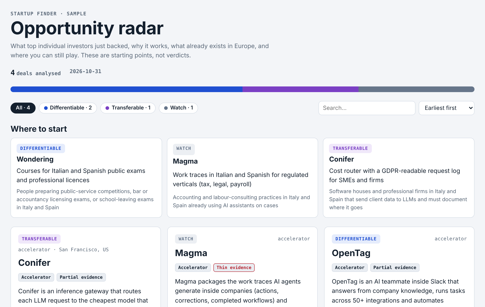

# Startup Finder

**See what the best early-stage investors in the US backed this month, and find your own angle on it in Europe.**

Startup Finder is a set of Claude agents. Point it at your PitchBook access and it:
1. **scouts** ~10 startups being born *now*: angel, pre-seed and accelerator deals from first-cheque investors, plus the latest YC batch;
2. writes one **Opportunity Card** per startup:
   - the non-obvious secret;
   - who already does it in Europe, and what they miss;
   - 3–5 concrete differentiation angles;
   - other sectors the idea could transfer to;
   - risks, questions for you, and a one-week test;
3. builds a **single HTML report** you can open in any browser.

It is an **inspiration engine, not an investment committee**. Competitors are information, not a reason to stop.

## What you need
- The **Claude desktop app** with Cowork (a Claude plan that includes it), and this folder connected.
- **Python 3.8+** with PyYAML (`pip install pyyaml`).
- **PitchBook access** through your own licence (university or company). Without it the tool still runs on public accelerator feeds, but the results are thinner.

## Start in 3 steps
1. Download or clone this repository and connect the folder in Claude (Cowork → add folder).
2. Open a new Cowork task and paste the prompt from [`START_HERE.md`](START_HERE.md).
3. Answer the 4 optional setup questions, check the time estimate (≈15–25 min for 10 startups), and say **Start**.

When it's done, open `runs/<run>/report.html`. The first run asks you to sign in to PitchBook in Claude's built-in browser. You type your credentials yourself; the agents never see them.

## What it costs in time
| Step | Typical time | Needs you? |
|---|---|---|
| Setup questions (first run only) | 1 min | yes |
| PitchBook sign-in check | 1–3 min | only if the session expired |
| Scouting | 8–12 min | no |
| Opportunity Cards (in parallel) | 4–7 min | no |
| Report | < 1 min | no |

The tool learns your real timings and shows a personal estimate before every run.

## Customise
- `config/user_profile.md`: who you are, the sectors you know, the report language (English by default; e.g. `it`, `es`).
- `config/run_config.yaml`: profile (`quick` ≈ 10 startups, `standard` ≈ 30), stages, sources.
- `config/starter_investors.yaml`: the investors whose first cheques you want to follow.

## How it works
See [`docs/ARCHITECTURE.md`](docs/ARCHITECTURE.md). In short: an orchestrator, a scout, an opportunity lab and a light retrospective that writes lessons into `config/learnings.md`. A validator checks every file, and finished runs are sealed so history never changes silently.

## Important
Read [`DISCLAIMER.md`](DISCLAIMER.md). In short: use PitchBook only within your own licence; the agents read pages at human pace, never export and never run scripts on PitchBook. Never publish the `data/` or `runs/` folders, because they contain licensed data. The output is not financial, legal or investment advice.

## License
MIT. See [LICENSE](LICENSE).
